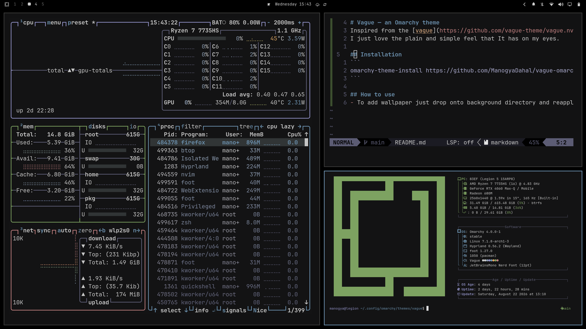

# Vague: an Omarchy theme



Inspired by [vague.nvim](https://github.com/vague-theme/vague.nvim), using the same color palette. Plain, muted, and easy on the eyes.

## Installation

```
omarchy-theme-install https://github.com/ManogyaDahal/vague-omarchy
```

## Usage

- **Wallpapers** — drop an image into `backgrounds/`, then reapply the theme.
- **Neovim** — `neovim.lua` installs and applies [vague.nvim](https://github.com/vague-theme/vague.nvim) automatically.

## Palette

| | Name | Hex |
|---|---|---|
|  | Background | `#141415` |
|  | Foreground | `#CDCDCD` |
|  | Accent | `#6E94B2` |
|  | Selection | `#333738` |
|  | Black | `#252530` |
|  | Red | `#C48282` |
|  | Green | `#7FA563` |
|  | Yellow | `#E0A363` |
|  | Blue | `#6E94B2` |
|  | Magenta | `#9595CB` |
|  | Cyan | `#90A0B5` |
|  | White | `#CDCDCD` |

Full 16-color set (including bright variants) lives in [`colors.toml`](./colors.toml).

## Structure

```
├── backgrounds/     # wallpapers
├── colors.toml      # base16-style palette
├── icons.theme      # icon theme mapping
├── neovim.lua       # vague.nvim integration
└── desktop.png       # preview
```

## Credits

- Palette and inspiration from [vague-theme/vague.nvim](https://github.com/vague-theme/vague.nvim)
